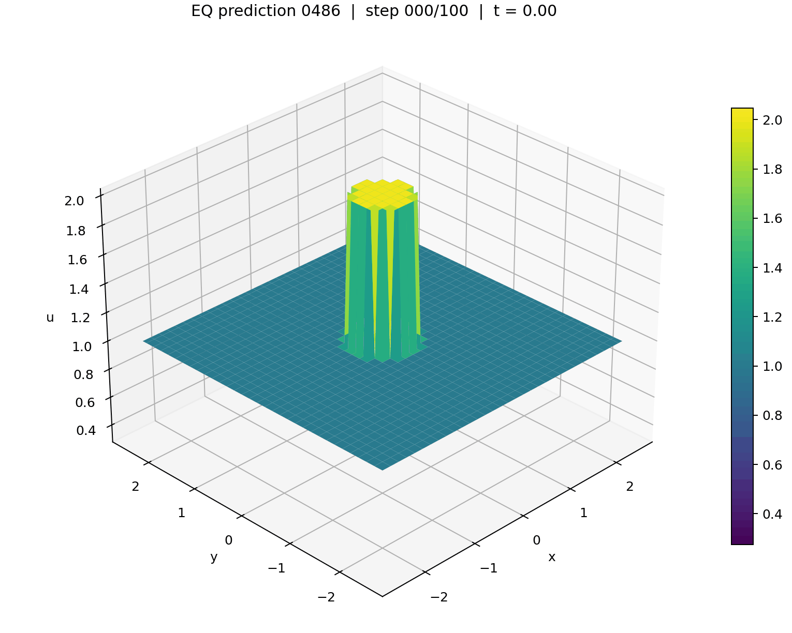

# D4-Equivariant PDE Transformer

This is my final project for the course **MMA440: Mathematical Structures of Deep Neural Networks**. I adapted group-equivariant vision Transformer components to PDE-Transformer for forecasting solutions of the shallow-water equations. The model respects the symmetries of the square: rotations by multiples of 90° and reflections. The project compares explicit equivariance with data augmentation, equivariance regularization, group averaging, and an FNO baseline.

**[Project PDF: Impact of Equivariance in Transformer-Based PDE Learning](docs/impact-of-equivariance.pdf)** — architecture, experiments, results, and conclusions.

| Ground truth | Equivariant prediction |
|:---:|:---:|
|  |  |

*Qualitative example from training trajectory 0486. See the PDF for test-set comparisons and compute tradeoffs.*

## Run

Use Python 3.11. The requirements retain the main versions used for the course experiments.

```bash
python3 -m venv .venv
source .venv/bin/activate
python -m pip install -r requirements.txt
python eq_deep_audit.py
python -m unittest discover -s tests -v
```

The checks run on synthetic inputs without a dataset. For training, obtain PDEBench's shallow-water file `2D_rdb_NA_NA.h5` separately and set its path:

```bash
export PDEBENCH_FILE=/path/to/2D_rdb_NA_NA.h5
python navierstokes_official.py --model_variant tiny_eq_paper \
  --epochs 10 --batch_size 8 --num_workers 0 --artifact_prefix eq
python evaluate_checkpoint_test_eval.py \
  --checkpoint output/eq_tiny_eq_paper_pde_model_optim_checkpoint.pt
```

Dataset and trained checkpoints are not bundled. Training starts fresh; continuation requires `--resume_checkpoint PATH`. Evaluation inherits the saved split seed and field. Use `--help` for rollout training and other options; install `requirements-fno.txt` for the FNO scripts.

## Code and attribution

- `pde_transformer_eq_paper.py`: group-mixing projections, canonical pair-orbit positional bias, and equivariant resampling.
- `pde_transformer_eq_local.py`: D4 actions and shared layers. The `tiny_eq` variant needs both `--eq_token_linear_shared` and `--eq_attention_shared_qkv` for strict equivariance.
- `navierstokes_official.py`: training, augmentation, consistency regularization, group averaging, and rollout prediction. The historical filename is retained; this project uses shallow-water data.
- `evaluate_checkpoint_test_eval.py`: one-step error, D4 error, and autoregressive rollout RMSE; `full_test_rollout_eval.py` compares the benchmark models.

Built on [PDE-Transformer](https://github.com/tum-pbs/pde-transformer), with D4 constructions adapted from [Vanilla Group Equivariant Vision Transformer](https://arxiv.org/abs/2602.08047). Data: [PDEBench](https://github.com/pdebench/PDEBench). FNO baseline: [neuraloperator](https://github.com/neuraloperator/neuraloperator). See [NOTICE.md](NOTICE.md) for attribution and the preserved upstream license.
